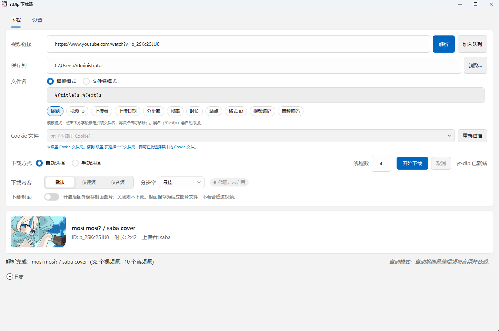
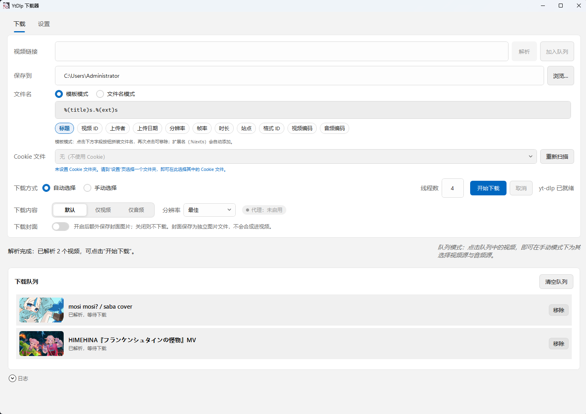
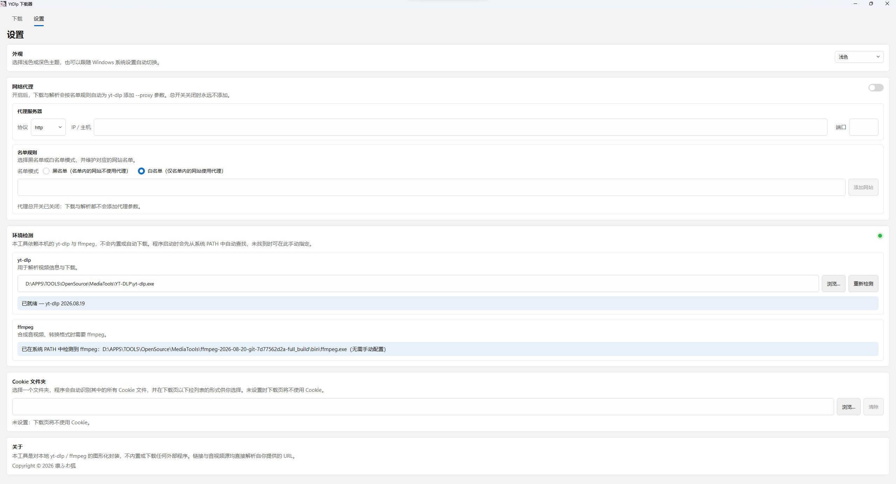

# YT-DLP Downloader

基于 **Tauri v2 + Rust** 与 **Svelte 5 + TypeScript** 的 Windows 桌面视频下载器。

它是本地 `yt-dlp` / `ffmpeg` 的图形化前端：**不内置、也不自动下载**这两个外部程序，所有解析与下载都由你机器上已有的 `yt-dlp` 完成。

## 截图

| 下载 | 队列 | 设置 |
| --- | --- | --- |
|  |  |  |

## 功能

**解析与下载**

- 输入视频链接即可解析标题、时长、上传者与封面；播放列表会自动展开，把列表中的视频全部加入下载队列。
- 支持下载队列：逐个解析、按顺序下载，队列项可单独移除或整体清空。
- 下载内容三选一：默认（视频 + 音频）、仅视频、仅音频。
- 自动选择：按“最佳 / > 4K / ≤ 4K / ≤ 2K / ≤ 1080P / ≤ 720P / ≤ 360P”挑选分辨率。
- 手动选择：列出全部视频源与音频源（格式 ID、分辨率、帧率、码率、编码、类型、容器），自己指定要下载的流。
- 实时进度条、速度、剩余时间与完整日志；支持取消（解析与下载共用同一个取消入口）。
- 直播 / 即将开始的直播会给出提示。

**文件名与附加内容**

- 模板模式：勾选字段拼出 `yt-dlp` 输出模板（标题、视频 ID、上传者、上传日期、分辨率、帧率、时长、站点、格式 ID、视频编码、音频编码），自动补上扩展名。
- 固定文件名模式：直接指定输出的基础文件名。
- 可选随视频保存一张独立封面图（`--write-thumbnail`，不会合成进视频）。
- 并发分片线程数可调（1–64，默认 4）。

**Cookie 与网络代理**

- 指定一个 Cookie 文件夹，程序自动扫描其中的 Cookie 文件，在下载页以下拉列表选择；未设置则不使用 Cookie。
- 代理总开关 + 协议（http / https / socks5）+ 主机与端口。
- 名单规则：白名单（只有名单内站点走代理）或黑名单（名单内站点不走代理），按规则自动为 `yt-dlp` 追加 `--proxy`。

**环境与体验**

- 启动时自动从系统 `PATH` 查找 `yt-dlp` 与 `ffmpeg`，状态一目了然，并提供手动指定路径与官方下载页入口。
- 浅色 / 深色 / 跟随系统三种主题。
- 任务栏进度条、下载完成后的系统通知、一键打开输出目录。

## 使用

### 直接运行

1. 准备好 `yt-dlp` 与 `ffmpeg`（见下方“外部依赖”），建议加入系统 `PATH`。
2. 运行 `YtDlpDownloader.exe`。若提示未找到程序，在“设置 → 环境检测”中手动指定路径即可。

### 外部依赖

本程序**不会**为你安装或下载这两个工具，请自行获取：

- yt-dlp：<https://github.com/yt-dlp/yt-dlp/releases>
- ffmpeg：<https://ffmpeg.org/download.html>（合成音视频、转换格式时需要）

Windows 10/11 需要 WebView2 运行时（Windows 11 与较新的 Windows 10 已内置）。

## 从源码构建

需要 Rust（≥ 1.80）与 Node.js。

```powershell
# 1. 构建前端（Tauri 会在编译期把 apps\desktop\dist 嵌进 exe）
cd apps\desktop
npm install

# 2. 回到仓库根目录，一键构建发行版
cd ..\..
powershell -ExecutionPolicy Bypass -File .\build-release.ps1
```

脚本会依次构建前端（若 `node_modules` 已存在）、编译 Rust 发行版，并把产物复制到
`release\YtDlpDownloader.exe`。

手动构建等价于：

```powershell
cargo build --release -p ytdlp-downloader-desktop --features custom-protocol
# 产物：target\release\ytdlp-downloader-desktop.exe
```

> `--features custom-protocol` 不能省。该 feature 决定应用是加载内嵌的前端资源还是去连
> `devUrl`；漏掉它时程序启动会报「localhost 拒绝连接」。

开发模式（热更新）：

```powershell
cd apps\desktop
npm run tauri dev
```

质量门禁（仓库没有 CI，需手动执行）：

```powershell
cargo test -p ytdlp-downloader-core   # 核心逻辑与集成测试
cargo fmt --all -- --check
cargo clippy --all-targets -- -D warnings
cd apps\desktop; npm run check; npm run build
```

## 项目结构

```
crates/ytdlp-core/          与界面无关的核心逻辑（模型、服务、取消、集成测试）
apps/desktop/               Svelte 5 + TypeScript 前端
  src/lib/                  状态仓库与编排（解析、队列、下载、进度、设置）
  src/views/                下载页与设置页
  src-tauri/                Tauri 应用：commands.rs / dto.rs / state.rs
assets/                     图标与截图
build-release.ps1           一键构建发行版
```

架构要点：**前端负责编排**（解析循环、队列、下载循环、进度聚合、任务栏与通知的生命周期），
Rust 侧的 Tauri 命令只是 `ytdlp-core` 的薄封装。设置以 JSON 持久化到
`%APPDATA%\YtDlpDownloader\settings.json`。

## 许可证

本项目采用 [YT-DLP Downloader 非商业相同方式共享许可证 1.0](LICENSE)：

- 允许使用、修改与分发；
- **禁止任何商业用途**；
- 分发演绎作品时必须沿用相同许可证并提供完整源代码，且保留署名与许可证声明。

Copyright © 2026 凛ふわ狐
